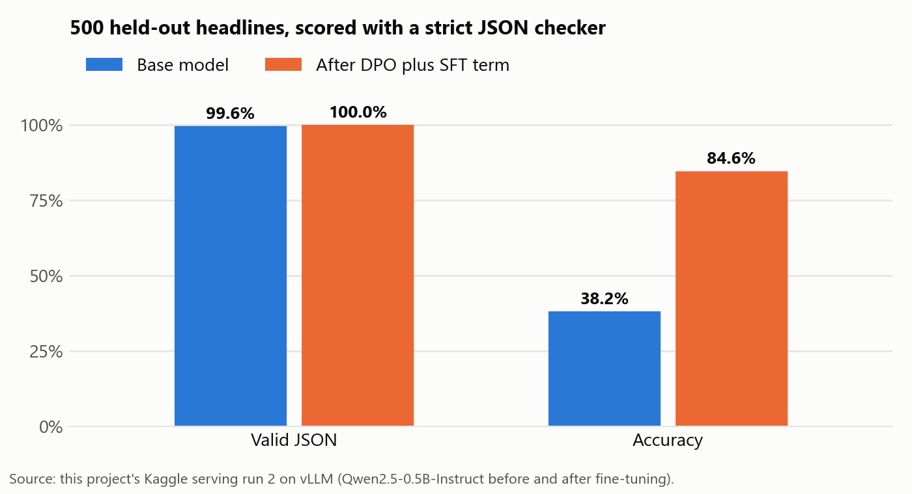
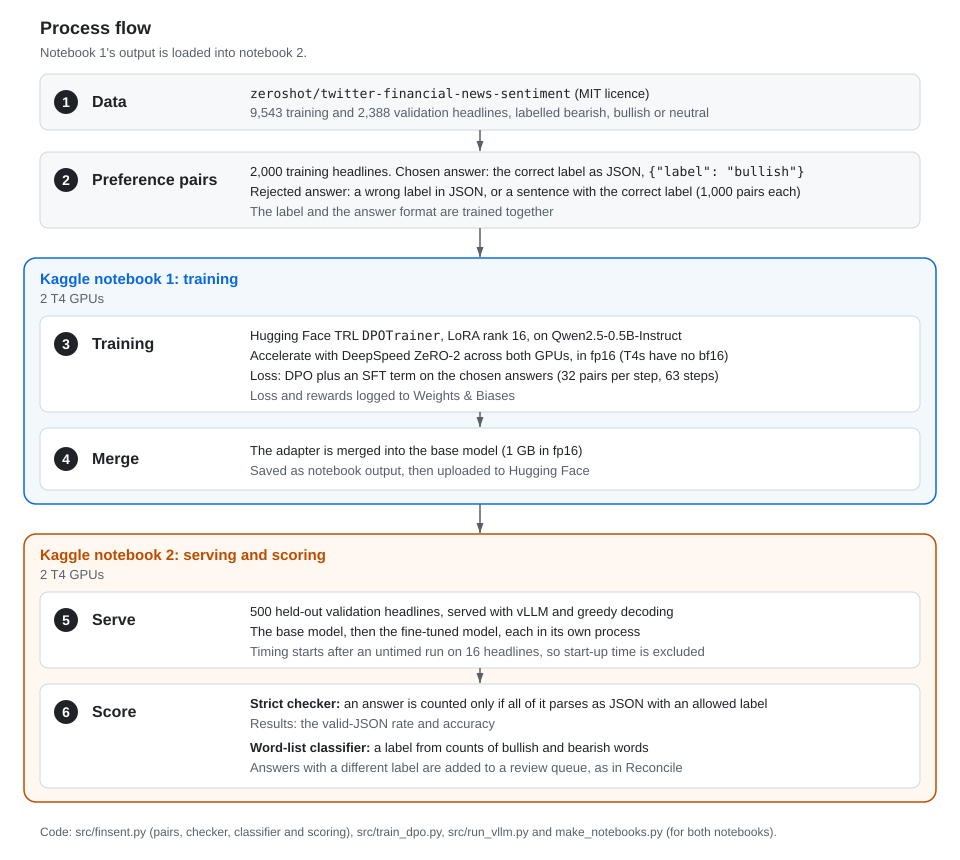
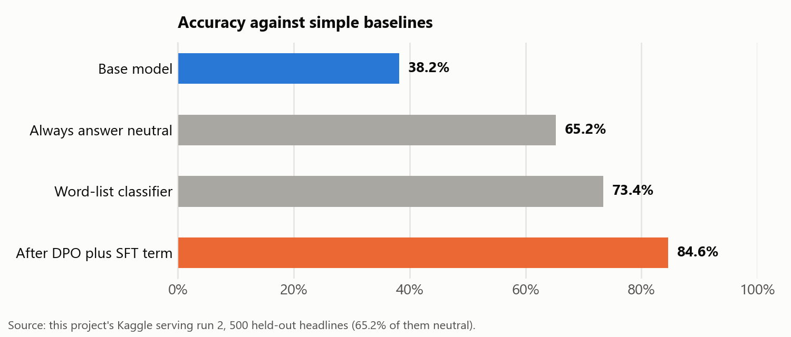
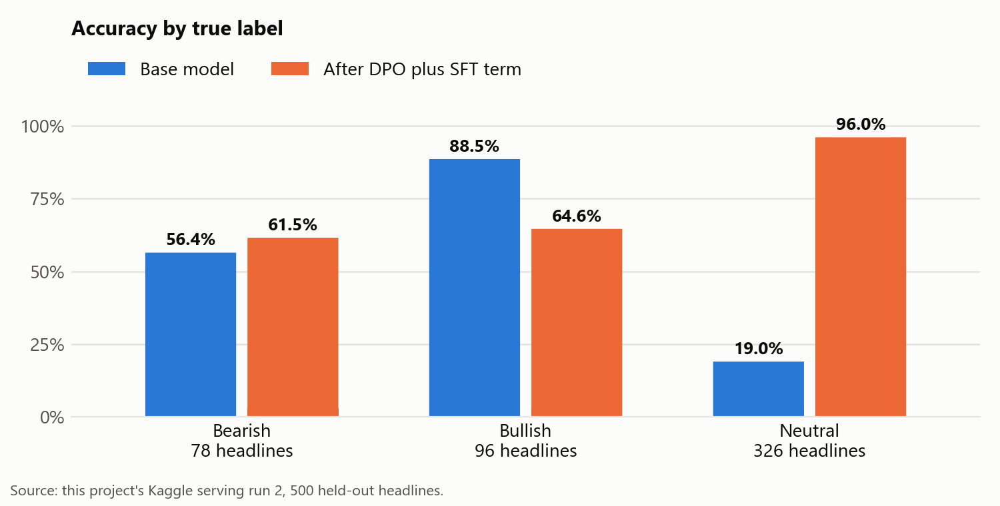
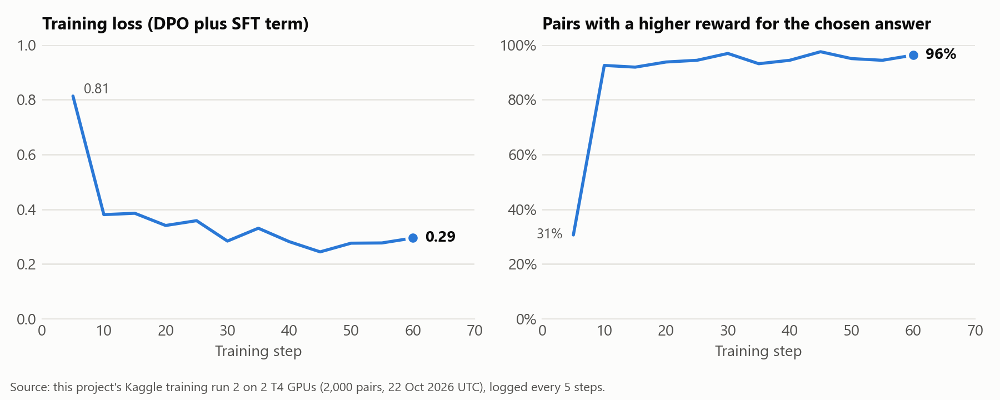
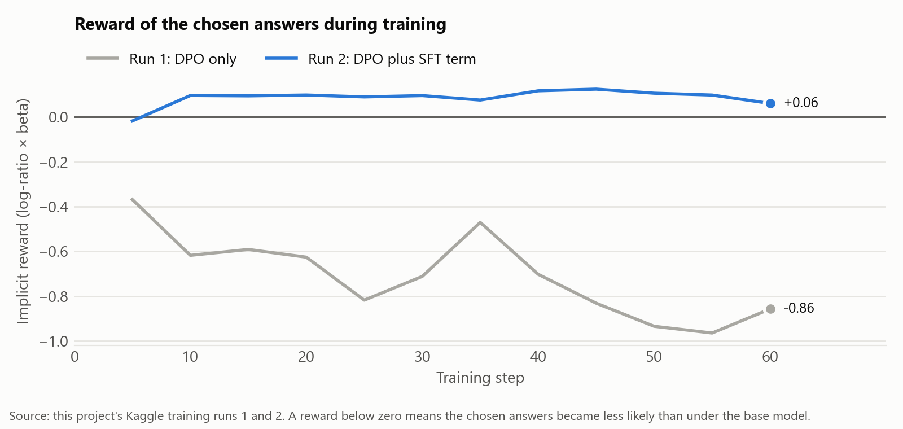

# Finance Headline Sentiment with DPO

I fine-tuned Qwen2.5-0.5B-Instruct with DPO plus an SFT term on 2 GPUs to label financial news headlines as bearish, bullish or neutral in JSON. Then I compared it with the base model on 500 held-out headlines.

*Run 2 on Kaggle, 22 Oct 2026. Accuracy rose from 38.2% to 84.6%, a gain of 46.4 points.*

## Summary

| Base model | Qwen2.5-0.5B-Instruct (Apache 2.0) |
|---|---|
| Data | 2,000 preference pairs from the twitter-financial-news-sentiment dataset (MIT) |
| Training | DPO plus an SFT term with LoRA rank 16 (Hugging Face TRL 1.16.0), 63 steps in 133.5 seconds on 2 T4 GPUs with DeepSpeed ZeRO-2 |
| Serving | vLLM 0.32.0, tensor parallel across 2 T4 GPUs |
| Test set | 500 held-out validation headlines, 65.2% of them neutral |
| Valid JSON | 99.6% to 100.0% |
| Accuracy | 38.2% to 84.6%. Answering neutral every time would be right 65.2% of the time. |
| Tests | 8 |

## Links

- [Training notebook on Kaggle](https://www.kaggle.com/code/sophiaizeiyamu/finance-headline-sentiment-dpo-training)
- [Serving notebook on Kaggle](https://www.kaggle.com/code/sophiaizeiyamu/finance-headline-sentiment-dpo-serving)
- [Model on Hugging Face](https://huggingface.co/sophia-ize-iyamu/qwen2.5-0.5b-finsent-dpo)
- [Training runs on Weights & Biases](https://forge.coreweave.com/wandb/sophia-ize-iyamu-n-a/finsent-dpo)

## Goal

When a language model's answer doesn't parse, any code that depends on it fails. I wanted the correct sentiment label in strict JSON from a small open model, and I used rule-based checks to measure how often I got it. I also wanted practice with TRL, DeepSpeed, vLLM and Weights & Biases.

## Process flow

## Method

### Preference pairs

Each of the 2,000 training headlines has a chosen answer: the correct label in JSON, such as `{"label": "bullish"}`. Of the rejected answers, 1,000 are a wrong label in JSON, and the rest are sentences containing the correct label, which fail the JSON check.

### Training

- LoRA adapter (rank 16, all linear layers) on Qwen2.5-0.5B-Instruct, 1 epoch, learning rate 5e-5, beta 0.1.
- Each training step has 32 pairs (4 per GPU, with 4 accumulation steps), so 1 epoch is 63 steps.
- Accelerate with DeepSpeed ZeRO-2 across both T4 GPUs, in fp16. T4s have no bf16. I switch off TRL 1.x's default bf16 setting in the script.
- Loss: TRL's DPO loss plus an SFT term on the chosen answers, weighted equally (`loss_type=["sigmoid", "sft"]`). I added the SFT term after run 1, where I used DPO alone.
- After training, I merged the adapter into the base model and saved the result as a 1 GB fp16 model.

### Serving and scoring

- I served each model with vLLM in its own process, with greedy decoding and up to 32 new tokens.
- Strict checker: an answer is counted only if all of it parses as JSON with an allowed label.
- Word-list classifier: a label from counts of bullish and bearish words.
- Review queue: answers with a different label from the word-list classifier's, the same design as my Reconcile project.

## Results

| Run 2, 500 headlines | Base model | After fine-tuning | Change |
|---|---|---|---|
| Valid JSON | 99.6% | 100.0% | 0.4 points higher |
| Accuracy | 38.2% | 84.6% | 46.4 points higher |
| Wrong answers | 309 | 77 | 232 fewer |
| Answers in the review queue | 350 (70.0%) | 101 (20.2%) | 249 fewer |
| Wrong answers inside the review queue | 281 of 309 (90.9%) | 24 of 77 (31.2%) | 59.8 points lower share |
| Headlines per second, 2 T4 GPUs | 184.8 | 381.2 | 196.4 more, cause unknown |

Of the 500 headlines, 326 are neutral, so answering neutral every time would be right 65.2% of the time. The word-list classifier's accuracy is 73.4%. At 84.6%, the fine-tuned model is 19.4 points above the neutral baseline and 11.2 above the word-list classifier. The base model's 38.2% is 27.0 points below the neutral baseline.

Most of the gain was on neutral headlines, where accuracy rose from 19.0% to 96.0%. On bearish headlines, it went from 56.4% to 61.5%. Bullish accuracy started high, at 88.5%, because 350 of the base model's 500 answers were bullish. After fine-tuning, it was 64.6%, 24.0 points lower.

In run 2, the share of pairs with a higher reward for the chosen answer rose from 31% at step 5 to 96% at step 60. Over the same steps, the loss fell from 0.81 to 0.29.

## Run 1 and the fix

In run 1, I used DPO alone, with the labels written in the prompt as `{"label": "bearish" | "bullish" | "neutral"}`.

| Run 1, 500 headlines | Base model | After DPO |
|---|---|---|
| Valid JSON | 35.2% | 4.2% |
| Accuracy | 4.8% | 4.0% |

The pattern in the prompt reappeared in the base model's answers: 306 of 500 were `{"label": "bearish}`, with a quote missing. After DPO, 310 answers were `{"label": negative}`, a label absent from the training data. To rule out a serving fault, I reran both models on a laptop CPU in full precision, using test headlines 1 to 20. Both failed the same way there, with 0 of 20 answers in valid JSON. On vLLM, the base model had 4 of 20 and the DPO model 1 of 20.

The DPO loss depends on the gap between the chosen and rejected answers, so the chosen answers' probability can fall as long as the rejected answers' probability falls faster. In run 1, both dropped. At step 60, the chosen answers' implicit reward (the log-probability ratio against the base model, times beta) was -0.86.

For run 2, I changed the prompt and the loss:

1. A clearer prompt: *Classify the sentiment of this financial news headline as bearish, bullish or neutral. Reply with JSON only, for example {"label": "neutral"}.* With this prompt on CPU, using test headlines 1 to 40, all 40 base-model answers were valid JSON, and 7 had the correct label.
2. An SFT term added to the DPO loss, so the chosen answers are also trained on directly. Their reward was above zero from step 10 on, at +0.06 by step 60, against -0.86 in run 1.

## Run it yourself

1. Create a Kaggle account and verify your phone number, which Kaggle requires for GPUs and internet access. Save a Kaggle API token in the `KAGGLE_API_TOKEN` environment variable.
2. Run `python make_notebooks.py <kaggle-username>` to build both notebooks from the code in `src/`.
3. Run `kaggle kernels push -p notebooks/train`. When it finishes, run `kaggle kernels push -p notebooks/serve`. The training notebook's output is loaded into the serving notebook.
4. On Kaggle, Weights & Biases runs offline, so no key is stored there. Download each notebook's output, then upload its `wandb` folder with `wandb sync`.
5. For the local tests and charts, run `pip install -r requirements.txt`, then `pytest` and `python make_figures.py`.

### Kaggle notes

These fixes are already in the notebooks, written for Kaggle's October 2026 image (Python 3.13, NVIDIA driver 580):

- LoRA layers fail to build in PEFT 0.21 while Kaggle's torchao 0.10 is installed, so I uninstall torchao in the training notebook.
- I install vLLM with `uv pip install vllm --torch-backend=auto`, so the PyTorch build matches the GPU driver.
- Kaggle's torchaudio is built for another CUDA version. I remove it in the serving notebook, because vLLM fails to import while it's installed.
- Once generation ends, the vLLM process keeps running until its worker processes stop. My serving script exits directly once results are saved, and each attempt has a hard time limit and its own log file.
- I set `enforce_eager=True` to skip vLLM's compile step while I looked for the cause of a stall.
- My free Kaggle account had 6 GPU hours a week. Time on a stalled run is deducted from that allowance until the run is stopped under View Active Events.

## Limitations

- I tested a single small model (0.5 billion parameters) on short finance tweets only. Longer news text is untested.
- The rejected answers are synthetic. A deployed model's errors would be more varied.
- I wrote run 2's prompt after reading run 1's answers to the same 500 test headlines, and I checked it on test headlines 1 to 40. I'd get a fairer score from a new test split.
- Of the test headlines, 65.2% are neutral. The fine-tuned model's accuracy is 96.0% on those, but 61.5% on bearish and 64.6% on bullish ones.
- The word-list classifier is crude. The review queue has 24 of the fine-tuned model's 77 errors (31%), plus 77 correct answers.
- Throughput rose from 184.8 to 381.2 headlines per second, yet both models have the same size and similar answer lengths (6.9 and 6.3 tokens on average). The cause is still unknown, so I don't count the speed-up as a gain from fine-tuning.
- Both throughput numbers are low for vLLM in general, since I ran it in fp16 and eager mode on T4 GPUs.

## Files

| File | Contents |
|---|---|
| `src/finsent.py` | Prompt, preference pairs, strict checker, word-list classifier and scoring |
| `src/train_dpo.py` | Training: DPO plus an SFT term, with LoRA |
| `src/run_vllm.py` | vLLM serving for one model |
| `make_notebooks.py` | Code to build both Kaggle notebooks from `src/` |
| `notebooks/` | The generated notebooks and their `kernel-metadata.json` files |
| `results/run1/`, `results/run2/` | Raw answers, scores, training logs and run settings from each run |
| `make_figures.py` | Code for the charts in `docs/` |
| `tests/` | 8 tests for the checker, pairs, classifier and scoring |
